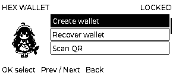
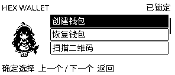

# HexWallet

[中文说明](README_CN.md) · [Documentation](wiki/Home.md) · [Validation records](wiki/validation.md) · [Four-screenshot review](wiki/Capability-Review.md)

HexWallet is offline transaction-review firmware for ESP32-P4 and ESP32-S3. The phone supplies the unsigned payload. The firmware parses the network, recipients, amounts and fees, presents the supported fields on the device and binds a local decision to the reviewed request. The phone submits the resulting transaction to its selected node.

**The board 7 build is diagnostic firmware.** Production wallet sessions return `CustodyUnavailable`. The SE051C2HQ1 transport, SCP03 and applet command code exist. Provisioning and transaction signing with non-exportable card keys still require implementation and physical acceptance. Recorded signatures use public test credentials on the host. [Secure element](wiki/Secure-Element.md) · [Security model](wiki/Security-Model.md)

## Board 7 and the review screen

| English | 简体中文 |
| --- | --- |
|  |  |

[All 44 states / 88 individual images](wiki/UI-Gallery.md) · [Filterable gallery](wiki/ui-gallery/index.html) · [Bilingual UI audit](wiki/UI-Audit-2026-11-24.md)

Each frame contains 296 × 128 pixels from the firmware's LVGL renderer and panel packing code running on the host. The setup pages explain the current secure-custody limitation. A public Ethereum payment illustrates scrolling, rejection and hold-to-approve. ZXing verifies the receive address from the panel pixels. Physical orientation, refresh time, ghosting and current draw await board measurements. [Board and display guide](wiki/Boards-and-Display.md)

| Component | Board 7 configuration |
| --- | --- |
| Processor and screen | ESP32-P4 post-v3, 2.9-inch SSD1680 monochrome e-paper, four application buttons |
| Peripherals | SE051C2HQ1 over I²C. SSD1680 and PN7161 share SPI GPIO7/8/9, with chip selects on GPIO16 and GPIO13 respectively |
| Flash | 32 MiB. The first 8 MiB hold the factory layout with two OTA slots. The remaining 24 MiB hold public asset data in LittleFS |
| Asset registry | 80 pinned token records. The application can persist 64 additional user-declared records |

## Build and validation

Install Arduino CLI and Python 3. From the sketch root, prepare the LVGL checkout and build the P4 image. The helper validates the selected core, chip revision, partition table and exact factory image length.

```powershell
arduino-cli core install esp32:esp32@3.3.13
git clone --depth 1 --branch v9.5.0 https://github.com/lvgl/lvgl.git "$HOME/Arduino/libraries/lvgl"
./tools/prepare_lvgl.ps1 -Directory "$HOME/Arduino/libraries/lvgl"
./tools/build_p4_board.ps1
```

The default output directory is `build/hexwallet-p4-v3`. The 8,388,608-byte merged image is for blank boards. Devices with existing credentials require a component-based migration that preserves NVS and its keys. Other S3/P4 configurations use Arduino-ESP32 3.3.10. The board guide includes the UART wiring required by rev A. [Build and flash](wiki/Build-and-Flash.md) · [Board pinouts](wiki/Boards-and-Display.md)

| Coverage | Recorded result |
| --- | --- |
| Catalog | 214 entries, of which 212 advertise review and signing. Hive exposes account-key signing. RyoCurrency and Zano expose receive addresses |
| Bitcoin and forks | PSBT v0/v2. The current host audit passes 172 checks. Compatible nodes accepted payments for 106 configurations. Seven currency-native nodes confirmed 16 payments |
| EVM | 82 native transfers on 62 network profiles matched ethers. A Chromium DApp discovered HexWallet through EIP-6963 and submitted an ETH transfer, Lido stake, Uniswap V2 swap and ERC-721 transfer. All four executed on a local Ethereum fork |
| Solana, Aptos and Cosmos | Eight transactions executed in LiteSVM. An Aptos private validator confirmed a payment. Twenty-four two-recipient Cosmos transactions on six networks matched CosmJS byte for byte |
| Zcash and ZERO | Native regtest nodes confirmed transparent ZEC NU7 v5/ZIP-244 and ZERO v4/ZIP-243 payments, including two-input spends |
| Ryo payments | The phone builder spent mature outputs in 25-member rings. After simulated panel approval in the host firmware, stock `ryod` confirmed the one- and two-input transfers at heights 133 and 134 on a private fork. The recipient scanned both amounts and payment IDs. Card signing and physical panel approval remain open. [Receipts](wiki/validation.md) |
| Zano | The phone verified two existing v4 mainnet payments and built two new native-asset payments with fresh proofs. After simulated approval and host signing, an isolated testnet confirmed the new payments at heights 39 and 40. Upstream `simplewallet` independently recovered both amounts and their payment ID from a watch-only wallet. The release catalog exposes addresses. Card-backed signing and GGXXG staking await validation. [Receipts](wiki/validation.md) |

Per-chain evidence identifies the verifier, network, operation and outcome. Hardware custody, physical approval through phone broadcast and third-party security review remain open. [Chain capabilities](wiki/Supported-Chains.md) · [Validation receipts](wiki/validation.md)

```powershell
./tests/host/build.ps1
./tests/host/psbt_audit/run.ps1
./tests/host/build_chain_native.ps1
./tests/host/ui_check.ps1
```

`psbt_audit/run.ps1` uses the pinned Mbed TLS checkout in `build/chain-mbedtls`. It records source hashes and individual results in `build/psbt-audit`. The serial CLI exposes its command list through `help`. Protocol integrations should use the published network identifiers, request formats, limits and approval lifecycle. [Testing](wiki/Testing.md) · [Payloads](wiki/Chain-Payloads.md) · [Phone protocol](wiki/Phone-Link.md)

## License

HexWallet Personal Non-Commercial Source License 1.0 permits personal non-commercial use by an individual. Commercial use requires a signed license. Third-party components retain their own terms. [License](LICENSE) · [Third-party notices](NOTICE)
