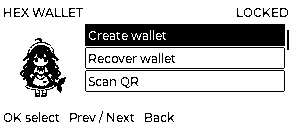
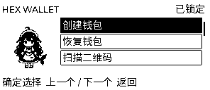

# HexWallet

[English](README.md) · [使用文档](wiki/Home-zh.md) · [验证记录](wiki/validation.md) · [四张原图逐项核对](wiki/Capability-Review-zh.md)

HexWallet 是面向 ESP32-P4 和 ESP32-S3 的离线交易审阅固件。手机提交未签名交易，固件按网络解析收款人、金额和费用，在设备上展示可核对的字段，并将用户的本地确认绑定到当次请求。手机取得签名结果后，向所选网络的节点提交交易。

**7 号板当前提供诊断固件。** 生产钱包会话返回 `CustodyUnavailable`。仓库已实现 SE051C2HQ1 传输、SCP03 和部分 applet 命令。使用不可导出密钥的开卡、派生与交易签名仍需完成集成和实卡验收。已记录的交易签名来自主机上的公开测试凭据。[安全芯片](wiki/Secure-Element-zh.md) · [安全模型](wiki/Security-Model-zh.md)

## 7 号板与设备审阅

| English | 简体中文 |
| --- | --- |
|  |  |

[逐屏查看中英文界面](wiki/UI-Gallery.md) · [可筛选图库](wiki/ui-gallery/index.html) · [双语界面审计](wiki/UI-Audit-2026-11-24-zh.md) · [配对与钱包加固](wiki/Wallet-Hardening-2026-11-24.md)

资产目录可在设置中切换列表、网格和圆角卡片。收款二维码固定在横屏左侧或竖屏上方，完整地址和派生路径可独立滚动。中英键盘支持实体键、触摸和离线拼音选字。

主机测试覆盖 BIP39 英文、简体和繁体词表的全部五种长度，以及比特币 WIF、十六进制私钥和 BIP38 备份。BIP38 支持直接加密，并可解密直接加密或 EC 乘法生成的备份。本地 NFC 备份流程读取一条 NFC-A Type 4 标签上的 NDEF Text 记录，恢复手机监听后才将密钥文本交给地址核对流程。射频读卡及 SE051 卡内托管仍待实机验收。原工程的 OV9281 接口与 U2 共用 SCCB/I²C 总线，摄像头采集和扫码导入仍待板级集成。

每幅画面保留 296 × 128 个像素，由主机运行固件的 LVGL 界面和面板打包代码生成。创建和恢复页面说明当前安全托管状态。公开的 ETH 付款示例展示滚动、拒绝和长按批准。ZXing 从面板像素读回收款地址。安装方向、刷新耗时、残影和电流仍待实物核验。[板卡与显示](wiki/Boards-and-Display-zh.md)

| 部件 | 7 号板配置 |
| --- | --- |
| 处理器与屏幕 | ESP32-P4 post-v3，2.9 寸 SSD1680 黑白墨水屏，四枚应用按键 |
| 外设 | SE051C2HQ1 通过 I²C 连接。屏幕与 PN7161 共用 GPIO7/8/9，片选分别为 GPIO16、GPIO13 |
| Flash | 支持 8 MiB 或 32 MiB 外置 NOR，两种布局均含双 OTA 槽。原工程 U7 预留 8 MiB，构建时按实装容量选择 |
| 资产登记 | 内置 80 条代币记录，应用最多另存 64 条用户声明的记录 |

## 构建与验证

安装 Arduino CLI 和 Python 3，在仓库根目录准备 LVGL 并构建 P4 固件。脚本校验开发板核心版本、芯片修订、分区表及出厂镜像的精确长度。

```powershell
arduino-cli core install esp32:esp32@3.3.13
git clone --depth 1 --branch v9.5.0 https://github.com/lvgl/lvgl.git "$HOME/Arduino/libraries/lvgl"
./tools/prepare_lvgl.ps1 -Directory "$HOME/Arduino/libraries/lvgl"
./tools/build_p4_board.ps1
```

默认输出目录为 `build/hexwallet-p4-v3`。8,388,608 字节的合并镜像适用于空板。已有凭据的设备须按组件迁移，保留 NVS 和密钥分区。其余 S3/P4 配置使用 Arduino-ESP32 3.3.10。rev A 板的 UART 接线见板卡文档。[构建与刷写](wiki/Build-and-Flash-zh.md) · [引脚说明](wiki/Boards-and-Display-zh.md)

| 范围 | 已记录的验证结果 |
| --- | --- |
| 钱包目录 | 214 个条目，其中 212 个声明交易审阅和签名能力。Hive 提供账户密钥签名。RyoCurrency 和 Zano 开放收款地址 |
| Bitcoin 及分叉 | 支持 PSBT v0/v2。当前主机审计通过 172 项。106 个配置的付款进入兼容节点区块，7 种货币的原生节点共确认 16 笔付款 |
| EVM | 62 个网络配置的 82 笔原生币转账与 ethers 签名一致。Chromium 中的 DApp 通过 EIP-6963 发现钱包并提交 ETH 转账、Lido 质押、Uniswap V2 兑换和 ERC-721 转账，四笔均在 Ethereum 本地分叉执行成功 |
| Solana、Aptos 与 Cosmos | LiteSVM 执行 8 笔交易。Aptos 私有验证节点确认一笔付款。6 个 Cosmos 网络的 24 笔双收款人交易与 CosmJS 逐字节一致 |
| Zcash 与 ZERO | 原生 regtest 节点分别确认 ZEC NU7 v5/ZIP-244 和 ZERO v4/ZIP-243 透明付款，包含双输入交易 |
| Ryo 付款 | 手机侧构建器使用已解锁的资金输出和 25 成员环。主机固件模拟面板批准后，官方 `ryod` 在隔离分叉的高度 133、134 分别确认单输入和双输入付款。收款方扫出两笔金额和 payment ID。实卡签名与实物面板批准待验收。[交易与区块](wiki/validation.md) |
| Zano | 手机端验证了两笔已有的主网 v4 付款，并构建了两笔新的原生资产付款及全部证明。主机固件经模拟按键批准后签名，隔离测试链在高度 39、40 确认。上游 `simplewallet` 使用只读钱包独立扫出两笔金额和 payment ID。发布目录开放地址，卡内签名与 GGXXG 质押待验收。[交易回执](wiki/validation.md) |

逐链记录列出验证器、网络、交易类型及结果。实卡托管、从设备确认到手机广播的实物验收，以及独立第三方安全审计仍待完成。[逐链能力表](wiki/Supported-Chains-zh.md) · [节点回执与验证记录](wiki/validation.md)

```powershell
./tests/host/build.ps1
./tests/host/psbt_audit/run.ps1
./tests/host/build_chain_native.ps1
./tests/host/ui_check.ps1
```

`psbt_audit/run.ps1` 使用 `build/chain-mbedtls` 中固定版本的 Mbed TLS，在 `build/psbt-audit` 保存源码哈希与逐项结果。串口命令由 `help` 列出。对接手机时应使用协议文档中的网络标识、请求格式、长度限制和批准流程。[测试方法](wiki/Testing-zh.md) · [交易载荷](wiki/Chain-Payloads-zh.md) · [手机协议](wiki/Phone-Link-zh.md)

## 许可证

HexWallet Personal Non-Commercial Source License 1.0 允许个人非商业使用，商业用途须另行取得书面许可。第三方组件沿用各自的许可条款。[许可证](LICENSE) · [第三方声明](NOTICE)
