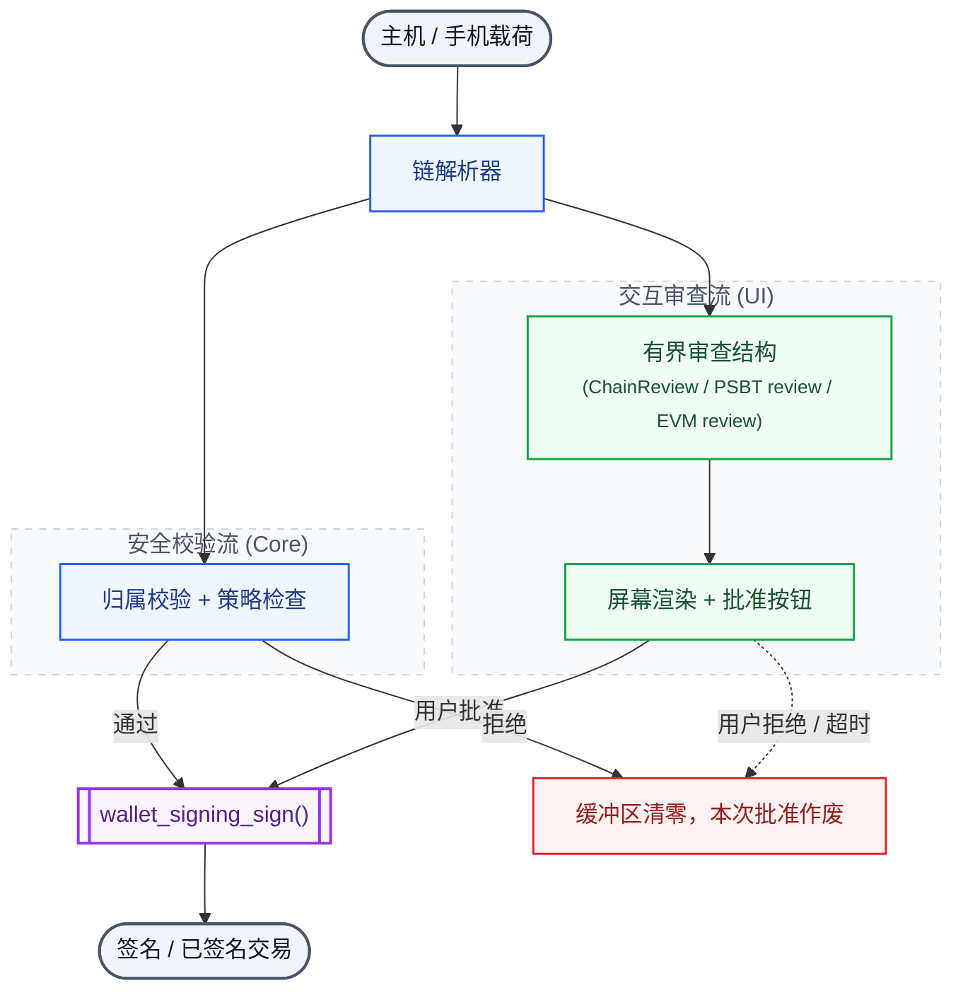

# 架构

[English](Architecture) · [首页](Home-zh)

固件就是一个 Arduino sketch。所有编译单元都放在仓库根目录，因为 sketch 目录同时被当作库根；
`src/` 里放的是生成的表和曲线抽象，不是业务代码。

## 执行模型

| 运行环境 | 栈 | 负责 |
| --- | --- | --- |
| Arduino loop 任务（core 1） | 32 KiB（`SET_LOOP_TASK_STACK_SIZE`） | 串口 CLI、UI 事件循环、NFC、按键轮询 |
| `hexwallet-crypto` worker（core 0） | 24 KiB | 所有耗时曲线运算：ECDSA、Schnorr、CLSAG、ML-DSA、BLS、XMSS |
| host 测试 | 进程栈 | 同一份源码，加 `HEXWALLET_HOST_TEST=1` 编译 |

交接由 `wallet_worker_execute()` 负责。它不会强杀正在跑的任务：曲线运算没有安全的取消点，
在 worker 还持有调用方栈或交易缓冲指针时返回，等于埋一个 use-after-free。它的做法是等任务排空，
期间继续刷新界面，只有在任务真正结束且截止时间已过时才返回 `TimedOut`。调用方必须把 `TimedOut`
当成"没有签名"。

host 后端在 `wallet_worker_wait()` 里同步执行任务，所以同一批调用点在不用 FreeRTOS 的情况下也测得到。

## 会话模型

`WalletSession` 是助记词的唯一持有者，按两种互斥形态编译：

- **host 测试**（`HEXWALLET_HOST_TEST=1` 且 `HEXWALLET_REQUIRE_SECURE_CUSTODY=0`）：一个 256 字节
  助记词缓冲，在 `wallet_session_clear()`、平台会话超时或 `lock` 时清零。
- **设备**（其余全部情况）：根本没有助记词存储。`wallet_session_generate()`、`wallet_session_import()`
  和两个 load 函数一律返回 `CustodyUnavailable`。

第二点是项目当前最诚实的状态：**现有设备固件无法创建、导入或使用钱包**。唯一能工作的密钥路径是
MCU RAM 里的明文种子，而这正是托管策略禁止的东西。把 SE051 通道变成可用的签名后端，是待完成的工作项，
不是一个配置开关。

## 签名流水线

由此得到的性质：

- 解析发生在接触密钥之前。格式错误的数据永远走不到曲线运算。
- 审查结构被复制进签名会话，签名前从载荷重新推导并逐字段比对。签的字节就是显示的字节。
- `wallet_signing_sign()` 先消耗批准，再解封密钥。之后任何一步失败，会话都不能再用。
- `SigningOutputGuard` 会清零调用方的输出缓冲区，除非生产者显式提交一个非零且不超过声明容量的长度。

## 模块分工

| 模块 | 职责 | 依赖 |
| --- | --- | --- |
| `WalletConfig.h` | 全部编译期开关、上限、板型编号 | 无 |
| `WalletBoardPins.h` | 各板引脚常量 | `WalletConfig.h` |
| `WalletBoardPort` | 屏幕、触摸、电池、按键、USB 窗口 | 引脚 |
| `WalletSecurity` | BIP39、BIP32、secp256k1/Ed25519 原语、PBKDF2、HMAC、清零 | mbedTLS |
| `WalletEngine` | 路径构造、地址派生、面向托管的密钥材料 | networks、security |
| `WalletNetworks` | 网络配置、地址编码、sighash 策略、Zcash 分支策略 | addresses |
| `WalletCatalog` | 面向用户的钱包条目与能力位 | networks |
| `WalletTokens` | 固定 token 记录与 calldata 登记 | calldata |
| `WalletSigning` | 审查→批准→签名会话、worker 调度 | adapters、UI、custody |
| `WalletUi` | 可信显示审查、批准回调、审查封印 | board port |
| `WalletCli` | 认证控制台、PIN verifier、失败退避 | session、signing |
| `WalletLink*` | 配对、X25519 + HKDF 会话、加密帧 | crypto |
| `WalletNfcApdu` / `WalletNfcPort` | ISO 7816-4 applet 与 PN7161 NCI 端口 | link |
| `Se051*` | APDU applet、SCP03、曲线映射、个人化 | secure element port |
| `*Transaction.*` | 每条链一个解析/序列化模块 | crypto primitives |

依赖方向是单向的：适配器不调用 UI，UI 不解析载荷，板级层看不到密钥材料。显示任务和 worker 之间唯一的
共享状态就是签名会话，而它在结构上只允许一个消费者。

## 生成的数据表

编译期表都是生成的，不靠手改；CI 会用 `--check` 重新跑生成器：

| 表 | 来源 | 生成器 |
| --- | --- | --- |
| `src/generated/WalletForkProfiles.inc` | `tools/fork_registry.json` | 人工逐条核对 `chainparams` 后登记 |
| `src/generated/WalletMiningCatalog.inc` | MiningPoolStats 快照 + 人工映射 | `tools/generate_mining_catalog.py` |
| `src/generated/CoinIcons.inc` | CC0 图标 | `tools/pack_coin_icons.ps1` |
| `src/generated/MaidSprite.inc` | 精灵图 | `tools/pack_maid_sprite.ps1` |
| `wiki/miningpoolstats-coverage.md` | 同一个生成器 | `tools/generate_mining_catalog.py` |

`tools/native_coverage.ps1` 会把解析后的目录导出到 `wiki/native-chain-capabilities.md`，所以发布出去的
能力矩阵是从编译产物跑出来的，不是手写的。

## 内存与失败行为

- 固件里不用 STL 容器、不用 `String`、不用异常。缓冲区全部定长，每个边界都校验长度。
- 堆只用于有界且检查过空指针的工作区（ML-DSA-87、BLS12-381、base58 临时缓冲）。签名路径上没有任何
  随输入增长的分配。
- 每个子系统都有自己的错误枚举（`WalletError`、`ChainError`、`TransactionError`、`WalletSigningError`、
  `Se051Error`）和固定文案；调用方编不出一个"成功"。
- 秘密放在 `SensitiveValue<T>` 里，不可拷贝，离开作用域即清零。它挡的是提前 return 和栈复用，
  挡不住被攻破的 MCU，也挡不住库内部的拷贝。

## 这套架构不做什么

- 它不跑节点。主机给的价值、手续费、nonce、UTxO、诱饵都是审查界面的输入；设备只检查它们内部一致、
  且属于本钱包，不检查它们是否真的存在于链上。
- 它不用 MPU 把各条链隔离开。某个解析器出内存破坏，可以碰到其它模块。
- 它不保护显示总线和 MCU 免受物理接触。见 [威胁模型](Threat-Model-zh)。
