# 双语界面逐格图库 / Bilingual UI gallery

44 个状态，每个中英文格子均为独立 PNG，点击查看原始 296 × 128 像素。
44 states, with a separate PNG in every English and Chinese cell. Click to open the native pixels.

主机 LVGL 测试夹具；创建、恢复、BIP38 和扫码尚未开放；各链动态详情尚未全面中文化。
Host LVGL fixtures; creation, recovery, BIP38 and camera capture are unavailable; protocol localization is incomplete.

[HTML 筛选图库 / Filterable gallery](ui-gallery/index.html) · [SHA-256](ui-gallery/manifest.json)

| 状态 / State | English | 简体中文 |
| --- | --- | --- |
| 01 · 主页 Home |  | [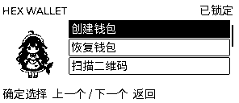](ui-gallery/zh-home.png) |
| 02 · 主页 / 语言入口 Home / language selected |  | [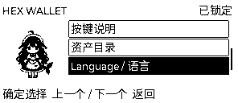](ui-gallery/zh-home-language.png) |
| 03 · 语言选择 Language | [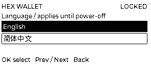](ui-gallery/en-language.png) | [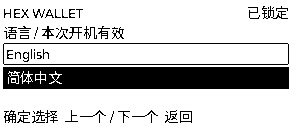](ui-gallery/zh-language.png) |
| 04 · 按键说明 Button guide |  |  |
| 05 · 按键说明 / 滚动 Button guide / scroll | [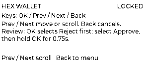](ui-gallery/en-controls-scroll.png) |  |
| 06 · 创建 / 备份方式 Create / backup type |  | [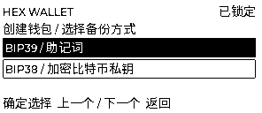](ui-gallery/zh-create.png) |
| 07 · 创建 / BIP39 尚未开放 Create / BIP39 unavailable | [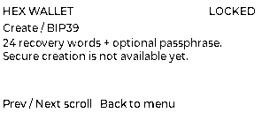](ui-gallery/en-create-words.png) |  |
| 08 · 创建 / BIP38 尚未开放 Create / BIP38 unavailable |  |  |
| 09 · 恢复 / 备份方式 Recover / backup type | [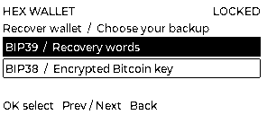](ui-gallery/en-recover.png) |  |
| 10 · 恢复 / BIP39 尚未开放 Recover / BIP39 unavailable | [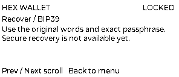](ui-gallery/en-recover-words.png) | [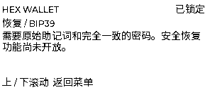](ui-gallery/zh-recover-words.png) |
| 11 · 恢复 / BIP38 尚未开放 Recover / BIP38 unavailable | [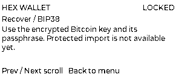](ui-gallery/en-recover-key.png) |  |
| 12 · 摄像头尚未开放 Camera unavailable |  |  |
| 13 · 资产目录 / 首页 Asset directory / first page |  | [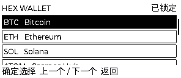](ui-gallery/zh-catalog.png) |
| 14 · 资产目录 / 下一页选中 Asset directory / next selected |  |  |
| 15 · 资产目录 / 末页 Asset directory / last page |  |  |
| 16 · 资产目录 / 空目录测试 Asset directory / empty fixture | [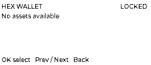](ui-gallery/en-catalog-empty.png) | [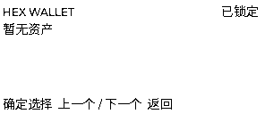](ui-gallery/zh-catalog-empty.png) |
| 17 · 资产详情 Asset details | [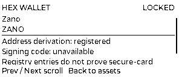](ui-gallery/en-asset.png) | [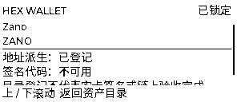](ui-gallery/zh-asset.png) |
| 18 · 资产详情 / 滚动 Asset details / scroll |  | [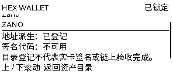](ui-gallery/zh-asset-scroll.png) |
| 19 · 收款 / 地址与二维码 Receive / address and QR |  | [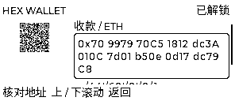](ui-gallery/zh-receive.png) |
| 20 · 收款 / 完整地址与路径 Receive / full address and path | [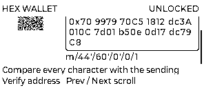](ui-gallery/en-receive-scroll.png) |  |
| 21 · 收款 / 核对提醒 Receive / verification reminder |  |  |
| 22 · 收款 / 长地址测试 Receive / long address fixture | [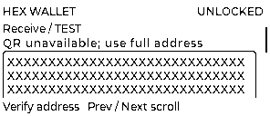](ui-gallery/en-receive-long.png) | [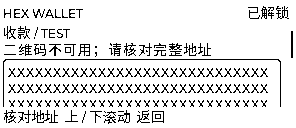](ui-gallery/zh-receive-long.png) |
| 23 · 收款 / 长地址末尾 Receive / long address end | [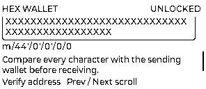](ui-gallery/en-receive-long-bottom.png) |  |
| 24 · 交易审阅 / 开始 Transaction / start |  |  |
| 25 · 交易审阅 / 滚动 Transaction / scroll | [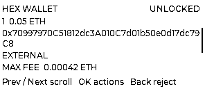](ui-gallery/en-scroll.png) |  |
| 26 · 交易审阅 / 拒绝选中 Transaction / reject selected |  |  |
| 27 · 交易审阅 / 长按批准 Transaction / hold to approve |  | [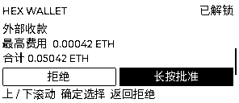](ui-gallery/zh-approval.png) |
| 28 · 批准 / 领取提示 Approval / collection notice |  |  |
| 29 · 串口审阅 / 确认码 Serial review / confirmation code |  | [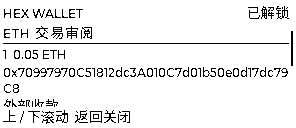](ui-gallery/zh-review-code.png) |
| 30 · 串口审阅 / 滚动 Serial review / scroll |  |  |
| 31 · 串口审阅 / 确认码与校验码 Serial review / code and seal |  | [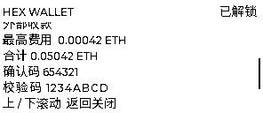](ui-gallery/zh-review-code-bottom.png) |
| 32 · 审阅 / 随机源失败 Review / entropy failure |  | [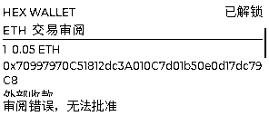](ui-gallery/zh-review-error.png) |
| 33 · 拒签 / 费用限制 Refusal / fee policy |  | [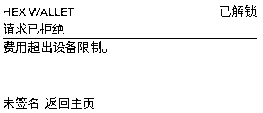](ui-gallery/zh-refused.png) |
| 34 · 拒签 / 网络不符 Refusal / wrong chain |  | [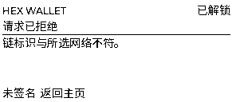](ui-gallery/zh-wrong-network.png) |
| 35 · 手机配对 / 码与指纹 Phone pairing / code and fingerprint |  | [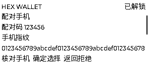](ui-gallery/zh-pairing.png) |
| 36 · 手机配对 / 滚动 Phone pairing / scroll |  | [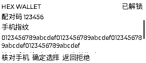](ui-gallery/zh-pairing-scroll.png) |
| 37 · 手机配对 / 拒绝选中 Phone pairing / reject selected | [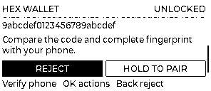](ui-gallery/en-pairing-reject.png) | [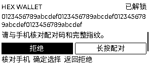](ui-gallery/zh-pairing-reject.png) |
| 38 · 手机配对 / 长按配对 Phone pairing / hold to pair | [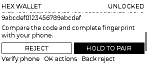](ui-gallery/en-pairing-approve.png) |  |
| 39 · 动态验证 / 验证码 Authenticator / code | [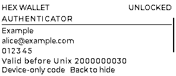](ui-gallery/en-otp.png) | [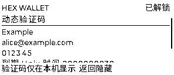](ui-gallery/zh-otp.png) |
| 40 · 动态验证 / 到期时间 Authenticator / expiry |  |  |
| 41 · 动态验证 / 会话提示 Authenticator / session notice |  | [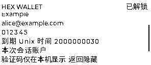](ui-gallery/zh-otp-bottom.png) |
| 42 · 正在处理 Processing | [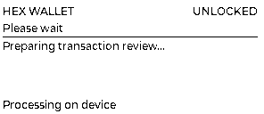](ui-gallery/en-busy.png) | [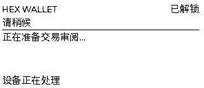](ui-gallery/zh-busy.png) |
| 43 · 长状态 / 可滚动 Long status / scrollable | [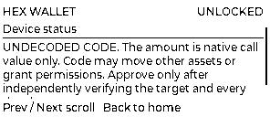](ui-gallery/en-status-long.png) |  |
| 44 · 显示接口错误 Display port error |  |  |
