# 双语界面逐格图库 / Bilingual UI gallery

66 个状态，每个中英文格子均为独立 PNG，点击查看原始 296 × 128 像素。
66 states, with a separate PNG in every English and Chinese cell. Click to open the native pixels.

画面由主机 LVGL 使用公开测试数据绘制。BIP38 可核对备份地址。生产卡内托管与相机采集仍待打通。
Host LVGL renders public fixtures, including BIP38 backup address checks. Production card custody and camera capture are pending.

[HTML 筛选图库 / Filterable gallery](ui-gallery/index.html) · [SHA-256](ui-gallery/manifest.json)

总览 / Overviews  [1](ui-gallery/overview-1.png) · [2](ui-gallery/overview-2.png) · [3](ui-gallery/overview-3.png) · [4](ui-gallery/overview-4.png) · [5](ui-gallery/overview-5.png) · [6](ui-gallery/overview-6.png) · [7](ui-gallery/overview-7.png) · [8](ui-gallery/overview-8.png) · [9](ui-gallery/overview-9.png)

| 状态 / State | English | 简体中文 |
| --- | --- | --- |
| 01 · 主页 Home | [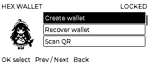](ui-gallery/en-home.png) |  |
| 02 · 主页 / 语言入口 Home / language selected | [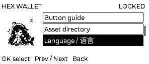](ui-gallery/en-home-language.png) |  |
| 03 · 语言选择 Language |  |  |
| 04 · 设置 Settings | [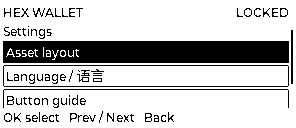](ui-gallery/en-settings.png) | [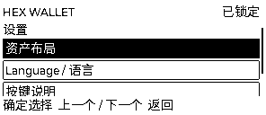](ui-gallery/zh-settings.png) |
| 05 · 资产布局 Asset layout | [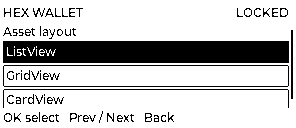](ui-gallery/en-layout.png) | [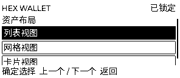](ui-gallery/zh-layout.png) |
| 06 · 搜索 / 四键键盘 Search / four-button keyboard | [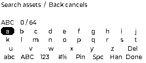](ui-gallery/en-keyboard.png) | [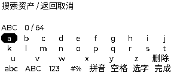](ui-gallery/zh-keyboard.png) |
| 07 · 拼音 / 候选字 Pinyin / character selection | [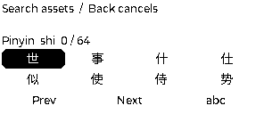](ui-gallery/en-keyboard-candidates.png) | [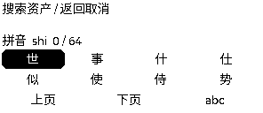](ui-gallery/zh-keyboard-candidates.png) |
| 08 · 网格视图 GridView | [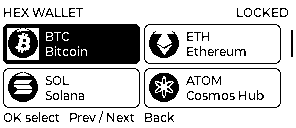](ui-gallery/en-catalog-grid.png) | [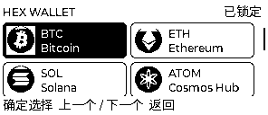](ui-gallery/zh-catalog-grid.png) |
| 09 · 卡片视图 CardView | [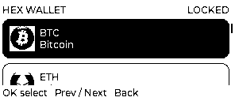](ui-gallery/en-catalog-card.png) | [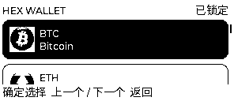](ui-gallery/zh-catalog-card.png) |
| 10 · DeepSeek 伙伴 DeepSeek companion | [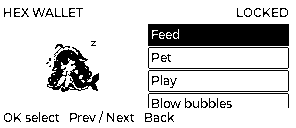](ui-gallery/en-companion.png) | [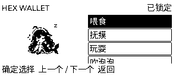](ui-gallery/zh-companion.png) |
| 11 · 伙伴 / 喂食 Companion / feed | [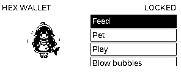](ui-gallery/en-companion-feed.png) | [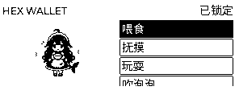](ui-gallery/zh-companion-feed.png) |
| 12 · 伙伴 / 吹泡泡 Companion / blow bubbles | [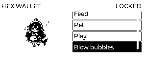](ui-gallery/en-companion-bubbles.png) | [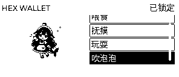](ui-gallery/zh-companion-bubbles.png) |
| 13 · 按键说明 Button guide |  |  |
| 14 · 按键说明 / 滚动 Button guide / scroll |  | [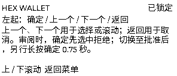](ui-gallery/zh-controls-scroll.png) |
| 15 · 创建 / 备份方式 Create / backup type | [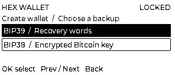](ui-gallery/en-create.png) |  |
| 16 · 创建 / BIP39 尚未开放 Create / BIP39 unavailable |  | [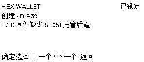](ui-gallery/zh-create-words.png) |
| 17 · BIP38 / 已锁定 BIP38 / locked | [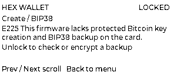](ui-gallery/en-create-key.png) | [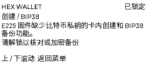](ui-gallery/zh-create-key.png) |
| 18 · 恢复 / 备份方式 Recover / backup type |  | [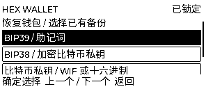](ui-gallery/zh-recover.png) |
| 19 · 恢复 / BIP39 尚未开放 Recover / BIP39 unavailable |  |  |
| 20 · 恢复 / 卡内导入状态 Recover / card import status |  | [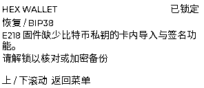](ui-gallery/zh-recover-key.png) |
| 21 · 比特币备份 / 网络 Bitcoin backup / network | [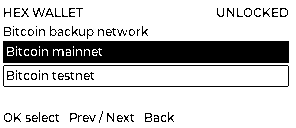](ui-gallery/en-backup-network.png) | [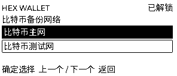](ui-gallery/zh-backup-network.png) |
| 22 · BIP38 备份 / 密码 BIP38 backup / password | [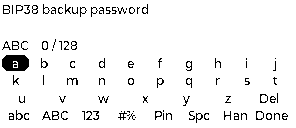](ui-gallery/en-backup-password.png) | [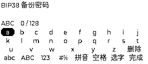](ui-gallery/zh-backup-password.png) |
| 23 · 比特币备份 / 取消 Bitcoin backup / cancel | [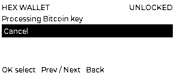](ui-gallery/en-backup-working.png) | [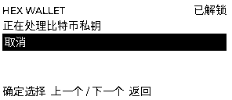](ui-gallery/zh-backup-working.png) |
| 24 · 比特币备份 / 核对地址 Bitcoin backup / address check | [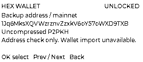](ui-gallery/en-backup-address.png) | [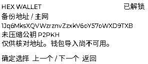](ui-gallery/zh-backup-address.png) |
| 25 · NFC 备份 / 放置标签 NFC backup / present tag | [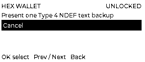](ui-gallery/en-backup-tag.png) | [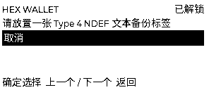](ui-gallery/zh-backup-tag.png) |
| 26 · 模拟托管 / 词表 Simulated custody / word list | [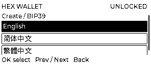](ui-gallery/en-mnemonic-language.png) | [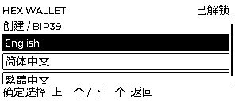](ui-gallery/zh-mnemonic-language.png) |
| 27 · 模拟托管 / 词数 Simulated custody / word count | [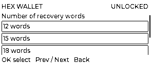](ui-gallery/en-mnemonic-count.png) | [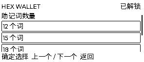](ui-gallery/zh-mnemonic-count.png) |
| 28 · 公开 BIP39 样例 / 抄写助记词 Public BIP39 fixture / write down words | [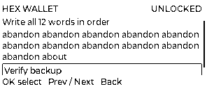](ui-gallery/en-mnemonic-backup.png) | [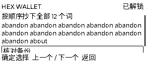](ui-gallery/zh-mnemonic-backup.png) |
| 29 · 模拟托管 / 重输助记词 Simulated custody / verify backup | [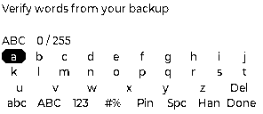](ui-gallery/en-mnemonic-retype.png) | [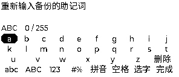](ui-gallery/zh-mnemonic-retype.png) |
| 30 · 模拟托管 / 附加密码选择 Simulated custody / passphrase choice | [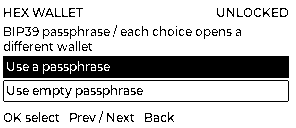](ui-gallery/en-mnemonic-passphrase.png) | [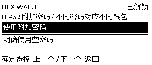](ui-gallery/zh-mnemonic-passphrase.png) |
| 31 · 模拟托管 / 确认创建 Simulated custody / confirm creation | [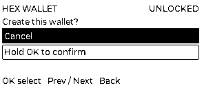](ui-gallery/en-mnemonic-create-confirm.png) | [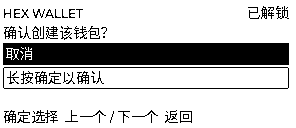](ui-gallery/zh-mnemonic-create-confirm.png) |
| 32 · 模拟托管 / 输入恢复助记词 Simulated custody / enter recovery words | [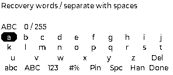](ui-gallery/en-mnemonic-recover.png) |  |
| 33 · 模拟托管 / 确认恢复 Simulated custody / confirm recovery |  |  |
| 34 · 摄像头尚未开放 Camera unavailable |  |  |
| 35 · 资产目录 / 首页 Asset directory / first page |  |  |
| 36 · 资产目录 / 下一页选中 Asset directory / next selected |  |  |
| 37 · 资产目录 / 末页 Asset directory / last page |  |  |
| 38 · 资产目录 / 空目录测试 Asset directory / empty fixture |  |  |
| 39 · 资产详情 Asset details |  |  |
| 40 · 资产详情 / 滚动 Asset details / scroll |  |  |
| 41 · 收款 / 地址与二维码 Receive / address and QR |  |  |
| 42 · 收款 / 完整地址与路径 Receive / full address and path |  |  |
| 43 · 收款 / 核对提醒 Receive / verification reminder |  |  |
| 44 · 收款 / 长地址测试 Receive / long address fixture |  |  |
| 45 · 收款 / 长地址末尾 Receive / long address end |  |  |
| 46 · 交易审阅 / 开始 Transaction / start |  |  |
| 47 · 交易审阅 / 滚动 Transaction / scroll |  |  |
| 48 · 交易审阅 / 拒绝选中 Transaction / reject selected |  |  |
| 49 · 交易审阅 / 长按批准 Transaction / hold to approve |  |  |
| 50 · 批准 / 领取提示 Approval / collection notice |  |  |
| 51 · 串口审阅 / 确认码 Serial review / confirmation code |  |  |
| 52 · 串口审阅 / 滚动 Serial review / scroll |  |  |
| 53 · 串口审阅 / 确认码与校验码 Serial review / code and seal |  |  |
| 54 · 审阅 / 随机源失败 Review / entropy failure |  |  |
| 55 · 拒签 / 费用限制 Refusal / fee policy |  |  |
| 56 · 拒签 / 网络不符 Refusal / wrong chain |  |  |
| 57 · 手机配对 / 码与指纹 Phone pairing / code and fingerprint |  |  |
| 58 · 手机配对 / 滚动 Phone pairing / scroll |  |  |
| 59 · 手机配对 / 拒绝选中 Phone pairing / reject selected |  |  |
| 60 · 手机配对 / 长按配对 Phone pairing / hold to pair |  |  |
| 61 · 动态验证 / 验证码 Authenticator / code |  |  |
| 62 · 动态验证 / 到期时间 Authenticator / expiry |  |  |
| 63 · 动态验证 / 会话提示 Authenticator / session notice |  |  |
| 64 · 正在处理 Processing |  |  |
| 65 · 长状态 / 可滚动 Long status / scrollable |  |  |
| 66 · 显示接口错误 Display port error |  |  |
